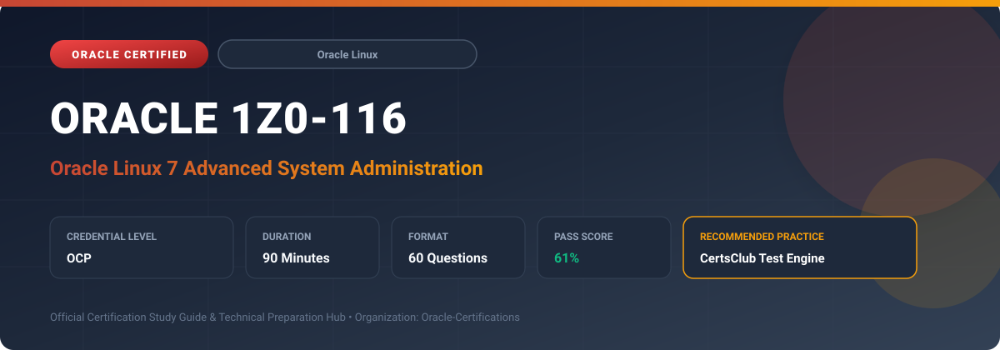

  

# Oracle 1Z0-116: Oracle Linux 7 Advanced System Administration

---

## 1. Exam Overview & Candidate Profile

The **Oracle 1Z0-116: Oracle Linux 7 Advanced System Administration** credential confirms advanced Linux systems administrators proficient in enterprise kernel configuration, security hardening, and performance troubleshooting.

Candidates validate deep expertise in Unbreakable Enterprise Kernel (UEK), Ksplice zero-downtime updates, Btrfs/XFS storage management, network teaming/bonding, control groups (cgroups), systemd services, and core dumps.

### Target Audience & Prerequisites
- **Target Roles**: Implementation Specialists, Cloud Architects, Technical Leads, Enterprise Consultants, and Systems Engineers.
- **Recommended Experience**: 1–2 years of practical, hands-on experience designing, implementing, and maintaining corresponding Oracle solutions.
- **Credential Earned**: OCP Certification.

---

## 2. Key Exam Specifications

| Specification | Details |
| :--- | :--- |
| **Exam Code** | **Oracle 1Z0-116** |
| **Official Title** | Oracle Linux 7 Advanced System Administration |
| **Certification Track** | Oracle Linux |
| **Exam Duration** | 90 Minutes |
| **Number of Questions** | 60 Questions |
| **Passing Score** | 61% |
| **Question Format** | Multiple Choice (Single/Multiple Answer), Scenario-Based Questions |
| **Delivery Provider** | Oracle University / Pearson VUE (Online Proctored or Test Center) |
| **Recommended Practice Engine** | [CertsClub Oracle Practice Tests](https://www.certsclub.com/oracle/1z0-116-dumps.html) |

---

## 3. Official Blueprint & Exam Domain Breakdown

The examination assesses candidate competencies across core functional domains weighted as follows:

| Domain Area | Weighting |
| :--- | :--- |
| **Unbreakable Enterprise Kernel (UEK) & Ksplice Updates** | `25%` |
| **Advanced Storage Management (Btrfs, LVM & Storage Pools)** | `25%` |
| **Advanced Networking, Teaming, Bonding & Firewalld** | `20%` |
| **System Resource Management (cgroups, systemd & PAM)** | `15%` |
| **Security Hardening, Core Dumps & System Troubleshooting** | `15%` |

---

## 4. Deep Dive into Complex & Challenging Technical Topics

To secure a passing score on the 1Z0-116 exam, candidates must master the following advanced concepts:

- Applying in-memory kernel and user-space security patches with zero downtime using Oracle Ksplice.
- Configuring Btrfs subvolumes, snapshots, RAID storage pools, and copy-on-write (CoW) features.
- Implementing Network Teaming and Bonding with link aggregation (LACP 802.3ad) and active-backup modes.
- Tuning Linux kernel parameters via sysctl and managing resource limits using systemd slices and cgroups.
- Analyzing memory exhaustion, kernel panics, kdump core collection, and crash analysis tools.

---

## 5. Scenario-Based Demo & Practice Questions

### Question 1
Which Oracle Linux technology allows administrators to apply critical Linux kernel security updates and CVE bug fixes on live production servers without rebooting the operating system?

A) Oracle Ksplice
B) Yum clean all
C) Systemd journalctl
D) Fdisk partition manager

- **Correct Answer**: `A) Oracle Ksplice`  
- **Technical Explanation**: Oracle Ksplice updates the running Linux kernel in memory without requiring a server reboot, ensuring 100% uptime for mission-critical enterprise workloads.

---

### Question 2
What command-line tool is used in Oracle Linux 7 to manage network team devices and query active link runner states?

A) teamdctl
B) ipconfig
C) iftop
D) route add

- **Correct Answer**: `A) teamdctl`  
- **Technical Explanation**: teamdctl is the control utility used to inspect, configure, and manage teamd network teaming daemon instances and monitor port status in Oracle Linux.

---

## 6. Recommended Preparation Strategy & Practice Testing Engine

Achieving certification in **Oracle 1Z0-116** requires balanced theoretical study and scenario-based simulation practice:

1. **Review Oracle Documentation**: Master architecture guides, implementation workbooks, and administration manuals on the Oracle Help Center.
2. **Hands-on Lab Practice**: Execute real-world configuration, policy setup, and troubleshooting tasks in your cloud tenancy or test instance.
3. **Simulated Exam Drills**: Practice answering timed, scenario-based multiple-choice questions to familiarize yourself with the question formats, traps, and timing constraints.

### Practice With CertsClub
For realistic practice questions, updated dumps, and mock testing environments:
- **Resource**: [CertsClub Oracle Practice Test Engine](https://www.certsclub.com/oracle/1z0-116-dumps.html)
- **Special Discount**: Use coupon code **`club20`** during checkout for an instant **20% discount** on all practice exam bundles and testing engines.

---

## 7. Official Documentation & References

- [Oracle University Certification Registry](https://education.oracle.com/)
- [Oracle Help Center Documentation Portal](https://docs.oracle.com/)
- [Oracle Cloud Infrastructure & Applications Guides](https://docs.oracle.com/en/cloud/)
- [CertsClub Oracle Certification Exam Practice](https://www.certsclub.com/oracle/1z0-116-dumps.html)

---

## 8. SEO & Discovery Keywords

`oracle 1z0-116, oracle 1z0-116 exam, oracle 1z0-116 dumps, 1Z0-116 practice questions, 1Z0-116 study guide, oracle linux 7 advanced system administration, certsclub 1z0-116`